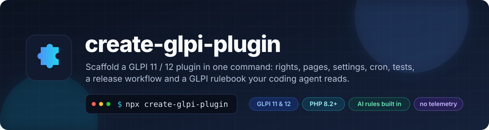
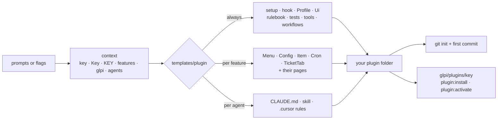

<p align="center">
  <a href="https://github.com/CodeByPinar/glpi-plugin-cli"></a>
</p>

<p align="center">
  <a href="https://www.npmjs.com/package/create-glpi-plugin"></a>
  <a href="https://www.npmjs.com/package/create-glpi-plugin"></a>
  
  
  
  <a href="https://github.com/CodeByPinar/glpi-plugin-cli/actions/workflows/ci.yml"></a>
  <a href="LICENSE"></a>
  
</p>

<p align="center">
  <b>English</b> · <a href="README.tr.md">Türkçe</a>
</p>

<p align="center">
  <a href="#-why">Why</a> ·
  <a href="#-quick-start">Quick start</a> ·
  <a href="#-what-you-get">What you get</a> ·
  <a href="#-the-parts">The parts</a> ·
  <a href="#-options">Options</a> ·
  <a href="#-one-code-base-for-glpi-11-and-12">GLPI 11 &amp; 12</a> ·
  <a href="#-ai-coding-agents">AI agents</a> ·
  <a href="#-the-generated-toolbox">Toolbox</a> ·
  <a href="#-your-first-feature">First feature</a> ·
  <a href="#-faq">FAQ</a> ·
  <a href="#-roadmap">Roadmap</a>
</p>

---

```bash
npx create-glpi-plugin
```

One command, a few questions, and you have a GLPI plugin that installs, shows up in the menu, has rights,
a settings page, an item type with search and history, a cron task, tests, a release pipeline, and a
rulebook of GLPI 11 / 12 traps that your coding agent reads before it touches a file.

<p align="center">
  
</p>

## 💡 Why

Writing a GLPI plugin is mostly ceremony before the first useful line, and most of that ceremony is undocumented:

| You want | You first have to know |
| :--- | :--- |
| A page under a menu entry | `setup.php` hook names, the `GlpiPlugin\Key` namespace, that `Html::header()` needs your menu class, that `$_SERVER['PHP_SELF']` as a form action silently posts to GLPI's inventory endpoint |
| A right per profile | one `glpi_profilerights` row per profile, a tab on the Profile form, a hook so new profiles get a row too |
| A setting | `glpi_configs` with a context, strings only, never reset on update |
| A table with a list | `CommonDBTM`, `rawSearchOptions()` ids that must never change, entity restriction, `public/` for assets, why `$rightname` cannot be declared when the class must load on GLPI 11 **and** 12 |
| To ship an update | that it must only *add* things, that GLPI rewrites the version before `install()` runs, that a version bump deactivates the plugin until someone clicks *Update* |
| CSRF to work | that GLPI 11 checks the token itself and a second check fails with 403, and that GLPI 12 has no tokens at all |

`create-glpi-plugin` writes all of this for you, correctly, in a shape you can read in ten minutes. The rules it
follows are also written down in `docs/glpi-rules.md` inside the plugin, each with the symptom it prevents, so the
next change you or your AI assistant make follows them too.

It is the GLPI counterpart of `create-next-app` or [ViraStack Start](https://github.com/virastack/start): a
scaffolder with the stack's conventions and an agent "constitution" built in. Everything it writes is plain PHP you
own. No runtime dependency on this tool, no framework, no telemetry.

## 🚀 Quick start

```bash
npx create-glpi-plugin                       # interactive
npx create-glpi-plugin myplugin --yes        # defaults: GLPI 11+12, menu + settings, Claude + Cursor rules, GPL
```

Then:

```bash
cp -r myplugin /var/www/glpi/plugins/        # or a symlink while developing
cd /var/www/glpi
php bin/console glpi:plugin:install myplugin -u glpi     # GLPI 12: plugin:install myplugin -u glpi
php bin/console glpi:plugin:activate myplugin
```

Open *Plugins → My Plugin* in GLPI. The overview page tells you what was generated and where to go next.

No GLPI at hand? The plugin ships with a throw-away one:

```bash
cd myplugin/docker && docker compose up -d   # http://localhost:8080, glpi / glpi, installs itself in about a minute
```

Requirements: Node.js 20 or newer for the CLI. The plugin needs PHP 8.2 (GLPI 11) or 8.3 (GLPI 12).

## 📦 What you get

```text
myplugin/
├── setup.php                     version, requirements, hooks, menu registration
├── hook.php                      install / update / uninstall — additive, migration-gated
├── plugin.xml                    GLPI plugin directory manifest
├── src/                          GlpiPlugin\Myplugin\… (PSR-4, autoloaded by GLPI, no inc/)
│   ├── Profile.php               rights: READ, UPDATE, CREATE/DELETE/PURGE, CONFIG + tab on Profiles
│   ├── Ui.php                    page header with pill navigation, url(), csrf(), need(), e()
│   ├── Menu.php                  menu entry with search / add / config links          [menu]
│   ├── Config.php                settings in glpi_configs, validated save, cached read [config]
│   ├── Item.php                  CommonDBTM: search engine list, form, history, entities [itemtype]
│   ├── Cron.php                  automatic action with parameter and log               [cron]
│   └── TicketTab.php             tab on every ticket                                   [tickettab]
├── front/                        index.php · config.php · item.php · item.form.php
├── public/css/myplugin.css       the only folder GLPI serves static files from
├── locales/                      myplugin.pot + an empty en_GB.mo (keeps __() fast)
├── docs/glpi-rules.md            GLPI 11 / 12 rules and traps, with symptoms
├── AGENTS.md                     short rules for any coding agent
├── CLAUDE.md                     + .claude/skills/glpi-plugin/SKILL.md                 [Claude Code]
├── .cursor/rules/glpi-plugin.mdc                                                       [Cursor]
├── tests/lint.sh                 php -l on everything
├── tests/loadcheck.php           loads every class against a GLPI checkout: catches signature fatals
├── tools/package.py              dist/myplugin-x.y.z.{tgz,zip,sha256} + release notes from the changelog
├── tools/i18n.sh                 .pot refresh, .po → .mo
├── docker/docker-compose.yml     official glpi/glpi image with the plugin mounted
├── .github/workflows/ci.yml      lint on PHP 8.2–8.4, real install on GLPI 11 and 12 images
├── .github/workflows/release.yml tag vX.Y.Z → archives + GitHub release
├── README.md · CHANGELOG.md · LICENSE · .gitignore · .gitattributes
```

Pieces marked `[…]` appear only when you select that part. Rights, `Ui`, the rulebook, the test and release
tooling are always there.

## 🧩 The parts

| Part | What it gives you | GLPI API it uses | Files |
| :--- | :--- | :--- | :--- |
| **Menu** | an entry in the sector you choose (Plugins, Tools, Assets, Assistance, Management, Administration, Setup) with search / add / settings links, and an overview page that lists what was generated, the user's rights, the cron state | `Hooks::MENU_TOADD`, `CommonGLPI::getMenuContent()`, `Hooks::ADD_CSS` | `src/Menu.php`, `front/index.php`, `public/css/` |
| **Settings** | a settings page reachable from *Setup → Plugins* and the pill navigation, three example fields (text, number, switch) with validation, defaults that are added on update and never overwritten | `Config::getConfigurationValues()` / `setConfigurationValues()`, `Hooks::CONFIG_PAGE` | `src/Config.php`, `front/config.php` |
| **Item type** | a table `glpi_plugin_myplugin_items`, GLPI's search engine (criteria, columns, export, massive actions), the standard form, history tab, entity restriction, create / update / purge with rights | `CommonDBTM`, `rawSearchOptions()`, `Search::show()`, `$item->display()` | `src/Item.php`, `front/item.php`, `front/item.form.php`, table in `hook.php` |
| **Automatic action** | a cron task visible in *Setup → Automatic actions*, with a parameter, a log line and the 1 / 0 / -1 return contract, registered idempotently | `CronTask::register()`, `cronInfo()`, `cron<Name>()` | `src/Cron.php` |
| **Ticket tab** | a tab on every ticket, the exact signatures GLPI expects, ready to be pointed at any other item type | `Plugin::registerClass(…, ['addtabon' => 'Ticket'])`, `getTabNameForItem()`, `displayTabContentForItem()` | `src/TicketTab.php` |
| **Rights** *(always)* | one right `plugin_myplugin` with GLPI's standard bits plus a `CONFIG` bit, a tab on *Administration → Profiles*, sensible defaults on a fresh install (admins get everything, central profiles read, self-service nothing), a row for every profile created later | `ProfileRight`, `displayRightsChoiceMatrix()`, `Hooks::ITEM_ADD` on Profile | `src/Profile.php` |
| **Ui** *(always)* | `Ui::header('page', $title)` draws GLPI's chrome, your title and the pill navigation; `Ui::url()` builds correct form actions; `Ui::csrf()` renders the token only where GLPI has one; `Ui::need(READ)` throws the right 403 on both versions | `Html::header()`, `Session::getNewCSRFToken()`, `AccessDeniedHttpException` | `src/Ui.php` |

Selecting **Item type** selects **Menu** too, because the item pages need somewhere to live.

## ⚙️ Options

Every prompt has a flag. A flag answers its prompt; `--yes` answers the rest with defaults.

```bash
npx create-glpi-plugin inventorynotes \
  --display "Inventory Notes" \
  --description "Free-text notes on any asset, with history" \
  --author "Ada O'Hara" \
  --glpi both \
  --features menu,itemtype,cron \
  --sector assets \
  --agent claude \
  --license GPL-3.0-or-later \
  --repo https://github.com/ada/glpi-inventorynotes \
  --yes
```

| Option | Values | Default |
| :--- | :--- | :--- |
| `[key]` | 2–30 lowercase letters and digits, starting with a letter. Becomes the folder, `GlpiPlugin\Key`, `glpi_plugin_key_*`, `plugin_key` | asked |
| `--display <name>` | display name in Setup → Plugins and the menu | key, capitalised |
| `--description <text>` | one line, shown under the page title and in `plugin.xml` | `<name> plugin for GLPI` |
| `--author <name>` | | `git config user.name` |
| `--glpi` | `both` · `11` · `12` | `both` |
| `--features` | comma-separated `menu`, `config`, `itemtype`, `cron`, `tickettab`, or `none` | `menu,config` |
| `--sector` | `plugins` · `tools` · `admin` · `management` · `assets` · `helpdesk` · `config` | `plugins` |
| `--agent` | `claude`, `cursor`, or `none` (AGENTS.md and the rulebook are always written) | `claude,cursor` |
| `--license` | `GPL-3.0-or-later` (GLPI's own) · `MIT` | `GPL-3.0-or-later` |
| `--repo <url>` | homepage written into `setup.php`, `plugin.xml`, README | placeholder |
| `--icon <class>` | [Tabler icon](https://tabler.io/icons) class for the menu and tabs | `ti ti-puzzle` |
| `--dir <path>` | output folder | `./<key>` |
| `--force` | write into a folder that is not empty | |
| `--no-git` | skip `git init` and the first commit | |
| `-y`, `--yes` | no prompts | |
| `--tr` | Turkish prompts (also picked when `LANG` starts with `tr`) | |
| `-v`, `--version` · `-h`, `--help` | | |

### Recipes

```bash
# the smallest thing that installs: rights + rulebook + tooling, nothing else
npx create-glpi-plugin ping --features none --agent none --yes

# GLPI 12 only, settings page, Cursor rules, MIT
npx create-glpi-plugin dash --glpi 12 --features menu,config --agent cursor --license MIT --yes

# everything, under the Assistance menu, Turkish prompts
npx create-glpi-plugin --tr --features menu,config,itemtype,cron,tickettab --sector helpdesk

# into the GLPI plugins folder directly
npx create-glpi-plugin notes --dir /var/www/glpi/plugins/notes --yes
```

## 🔀 One code base for GLPI 11 and 12

With `--glpi both` (the default) the generated code runs unchanged on both lines. These are the differences it
absorbs; the rulebook explains each with its symptom.

| Topic | GLPI 11 | GLPI 12 | What the generated code does |
| :--- | :--- | :--- | :--- |
| CSRF | `_glpi_csrf_token` in every POST, `Hooks::CSRF_COMPLIANT` | tokens and constant removed | `Ui::csrf()` renders the field only when `Session::getNewCSRFToken()` exists; the hook is registered behind `defined()`; pages never call `checkCSRF()` |
| `CommonGLPI::$rightname` | untyped | `string` | never redeclared: `canView()`…`canPurge()` are overridden and ask `Profile::has()` |
| `CommonDBTM::$dohistory` | untyped | `bool` | never redeclared: set in the constructor |
| Access denied | `Html::displayRightError()` | removed | `throw new AccessDeniedHttpException()` (works on both) |
| Raw SQL | `$DB->query()` deprecated | removed | `$DB->request()`, `insert()`, `update()`, `delete()`, `doQuery()` |
| Console | `glpi:plugin:install` | `plugin:install` | both documented in README, release notes and the overview |
| PHP | ≥ 8.2 | ≥ 8.3 | `requirements.php.min` follows the target |

Every method the generated classes override has the same signature in GLPI 11.0.8 and 12.0.0; the property types
above are the only breaks, and **`tests/loadcheck.php`** catches them without a browser or a database (see below).
With `--glpi 11` or `--glpi 12` the version-specific parts are dropped and `plugin.xml` lists only that line.

## 🤖 AI coding agents

Coding assistants do not know GLPI 11. They produce GLPI 9-era plugins (`inc/`, `PluginKeyClass`, `$_SERVER['PHP_SELF']`,
manual CSRF checks) that look right and fail in production. The generated plugin gives them the rules in the format
each tool reads:

| File | For | Content |
| :--- | :--- | :--- |
| `AGENTS.md` | every agent (Codex, Copilot, Claude, Cursor, …) | layout, the ten rules that are easy to break, commands, definition of done |
| `docs/glpi-rules.md` | humans and agents | the full rulebook: structure and naming, GLPI 11 vs 12, front pages, install / update, item types and the search engine, native forms, performance, testing without a browser, release checklist. Each rule names the symptom |
| `CLAUDE.md` | Claude Code | imports `AGENTS.md`, points to the skill and the verification commands |
| `.claude/skills/glpi-plugin/SKILL.md` | Claude Code | recipes: new page, new right, new setting, new column, new item type, new cron, tab on an object, hook on events, translation, release |
| `.cursor/rules/glpi-plugin.mdc` | Cursor | the short rules, always applied to PHP files |

The rulebook is field notes from shipping plugins on GLPI 11.0.x and 12.0.x, not a paraphrase of the official docs.
A taste:

> **Never use `$_SERVER['PHP_SELF']` as a form action.** GLPI 11's router resolves it to `/index.php`, the POST lands
> on the inventory agent endpoint and returns `<REPLY><ERROR>XML not well formed!</ERROR></REPLY>`.

> **Do not call `Session::checkCSRF()` in a page.** GLPI 11 validates every POST in a kernel listener and that
> validation *consumes* the single-use token, so your second check fails with 403.

> **`Html::redirect()` throws.** A `catch (\Throwable)` around it swallows the redirect and the page "succeeds" into
> the wrong place.

## 🧰 The generated toolbox

| Command | What it does |
| :--- | :--- |
| `bash tests/lint.sh` | `php -l` on every file |
| `bash tests/lint.sh /var/www/glpi` | … plus **the load check**: loads every plugin class against that GLPI's core classes without booting GLPI. A method whose signature drifted from GLPI's, or a property GLPI typed, is a compile-time fatal that GLPI's console never triggers and a browser shows as a white page. Here it is a red line in your terminal |
| `python tools/package.py` | builds `dist/myplugin-x.y.z.tgz`, `.zip`, `.sha256` with only the plugin files, the `myplugin/` folder at the archive root, root-owned, mode 644 — exactly what GLPI's installer and marketplace expect |
| `python tools/package.py --notes` | prints the changelog section of the current version with install instructions, used as release notes |
| `bash tools/i18n.sh` | refreshes `locales/myplugin.pot` from the sources (`__('…', 'myplugin')`, `_n`, `_x`, `_sx`) and compiles every `.po` to `.mo` |
| `cd docker && docker compose up -d` | GLPI 11 (or 12 with `GLPI_TAG=12.0`) at <http://localhost:8080> with the plugin folder mounted; edits show at once |
| `.github/workflows/ci.yml` | on push: syntax on PHP 8.2 / 8.3 / 8.4, then a **real install**: the official `glpi/glpi` image installs its database, `plugin:install`, `plugin:activate`, the load check inside the container, the login page answers |
| `.github/workflows/release.yml` | on `git tag vX.Y.Z`: checks the tag against `PLUGIN_MYPLUGIN_VERSION`, builds the archives, publishes a GitHub release with the changelog section as notes |

The install hook follows one rule that most plugins get wrong: **updates are additive**. Tables and columns are
added behind `tableExists()` / `fieldExists()`; rights are added only for profiles that have no row; settings are
added only when the key is missing; one-time migrations are gated on the version that ran `install()` before,
which `hook.php` keeps in a `schema_version` setting because GLPI overwrites `glpi_plugins.version` before calling
you. Reinstalling, upgrading, or running `plugin:install --force` never resets what an administrator configured.

## 🛠 Your first feature

Say you scaffolded `inventorynotes` with the item type. Turning the example `Item` into a *Note* attached to a
computer takes four edits, and the skill / rulebook walk an agent through the same steps:

1. **Column**: in `hook.php`, next to the `CREATE TABLE`, add
   `if (!$DB->fieldExists(Item::TABLE, 'computers_id')) { $DB->doQuery("ALTER TABLE … ADD `computers_id` INT … DEFAULT 0"); }`
   (install runs on update too, so this is also the migration for existing installs).
2. **Search option**: in `Item::rawSearchOptions()`, a new entry with a new id, `'table' => Computer::getTable()`,
   `'datatype' => 'dropdown'`. Ids are stored in saved searches: pick one and keep it.
3. **Form**: in `Item::showForm()`, `Computer::dropdown(['name' => 'computers_id', 'value' => $this->fields['computers_id']])`.
4. **Ship**: raise `PLUGIN_INVENTORYNOTES_VERSION`, add a changelog line, `git tag v0.2.0 && git push --tags`.
   Tell administrators the plugin shows "to update" and needs *Update → Enable*.

Want the notes as a tab on the computer instead? Copy `TicketTab.php`, change `Ticket` to `Computer`, register it
with `['addtabon' => 'Computer']`. Want a nightly clean-up? The `Cron` class is there with the return contract and
the parameter wired.

## 🔍 How it works



Templates are plain files with a tiny syntax: `{{key}}`, `{{#if menu}} … {{/if}}`, `{{#unless}}`, `{{else}}`. A
tag alone on its line disappears with the line, so the output has no gaps. Files that belong to a feature are
listed once in `CONDITIONAL_FILES` (`src/scaffold.js`). `__key__` in a file name becomes the key. There is no
runtime: the output is finished PHP.

## 📊 Compared with

| | Copy an existing plugin | GLPI's `example` plugin | `generator-glpi-plugin` (Yeoman, 2023) | **create-glpi-plugin** |
| :--- | :--- | :--- | :--- | :--- |
| Targets GLPI 11 / 12 | depends | yes | GLPI 9 | **both, one code base** |
| Rights, settings, item type, cron, tabs | whatever the donor had | demonstrates everything at once | skeleton only | **pick the parts** |
| Additive install / migrations | rarely | no | no | **yes, gated on previous version** |
| Catches GLPI 11 vs 12 signature fatals | no | no | no | **`tests/loadcheck.php`** |
| Tests, CI, release archives | your problem | no | no | **included** |
| Rules for coding agents | no | no | no | **AGENTS.md, rulebook, Claude skill, Cursor rules** |
| Turkish | | | | **prompts; code and docs in English** |

## ❓ FAQ

**Does the generated plugin depend on this tool?**
No. It is plain PHP in the layout GLPI expects. Delete nothing, keep everything, change anything.

**Why GPL-3.0-or-later by default?**
GLPI is GPL-3.0; a plugin that extends it usually is too. MIT is one flag away.

**Why does GLPI say "to update" after I changed the version?**
That is GLPI: when the files' version differs from the database's, the plugin is deactivated until someone clicks
*Update* then *Enable*. The generated install hook makes that click safe: nothing an administrator configured is
reset. Bump the version on every delivery so people can tell builds apart.

**Can I add a part later?**
Scaffold a scratch plugin with that part and copy the files over; every part is self-contained and documented in
the skill (`new item type`, `new cron`, `tab on an object`). A `create-glpi-plugin add <part>` command for existing
plugins is on the roadmap.

**Does it support GLPI 10?**
No. GLPI 10 has a different page lifecycle (no kernel, input sanitising, `inc/` autoload). Everything here is
written for 11 and 12.

**Why an empty `locales/en_GB.mo`?**
GLPI registers a plugin's text domain only when a `.mo` file exists. Without one, every `__('…', 'key')` call
re-runs the loader (≈150 µs each; a page with two thousand calls loses a third of a second). The empty file makes
the domain known; translate when you want to.

**Does it phone home?**
No. No telemetry, no update check, no network access except `npm` fetching the package.

**Is the interactive mode available in CI?**
Use `--yes` with flags; the prompts are skipped and a missing key is an error with a hint.

## 🗺 Roadmap

- `create-glpi-plugin add <part>` for existing plugins: `settings-page`, `dashboard-card`, `notification`,
  `form-destination` (GLPI 11 Forms), `rest-client`, `pill-menu`, fetched from a registry so new parts need no CLI release.
- `--template minimal|full` presets and a `--dry-run` that prints the file plan.
- Twig-based pages (`TemplateRenderer`) as an alternative to PHP-echoed HTML.
- PHPStan configuration with GLPI stubs in the generated plugin.
- A `composer create-project` wrapper for PHP-only environments.
- More languages for the prompts.

Ideas and bug reports: [issues](https://github.com/CodeByPinar/glpi-plugin-cli/issues).

## 🧑‍💻 Development

```bash
git clone https://github.com/CodeByPinar/glpi-plugin-cli && cd glpi-plugin-cli
npm install
npm run check          # node --check on every file + the test suite
node bin/create-glpi-plugin.js demo --yes --dir /tmp/demo
```

The suite scaffolds every feature combination into a temporary folder, verifies the file plan, checks that no
template syntax leaks, and runs `php -l` on the output when PHP is installed. CI additionally scaffolds a full
plugin and builds its release archives. The generated templates were installed, exercised (pages, item CRUD with
history, settings validation, 403s for a self-service user, cron, ticket tab, additive reinstall, uninstall
clean-up) and rendered in a browser on GLPI 11.0.8 and 12.0.0 before each release.

Layout of this repository:

```text
bin/create-glpi-plugin.js   entry point
src/index.js                flags → options
src/init.js                 prompts (@clack/prompts), scaffold, git, next steps
src/scaffold.js             context, feature → file map, template walk
src/render.js               the template syntax
src/mo.js                   the empty .mo
src/i18n.js                 English and Turkish strings
templates/plugin/           the plugin, with placeholders
templates/licenses/         GPL-3.0 and MIT texts
tests/                      node:test suites
```

## 🙏 Credits

- [GLPI](https://glpi-project.org) by Teclib' and contributors.
- [ViraStack Start](https://github.com/virastack/start) by Ömer Gülçiçek, for the idea that a scaffolder should
  ship the stack's rules for coding agents too.
- [@clack/prompts](https://github.com/bombshell-dev/clack) for the prompts.

## 📄 License

MIT © [Pınar Topuz](https://github.com/CodeByPinar). The generated plugin carries the license you choose.
