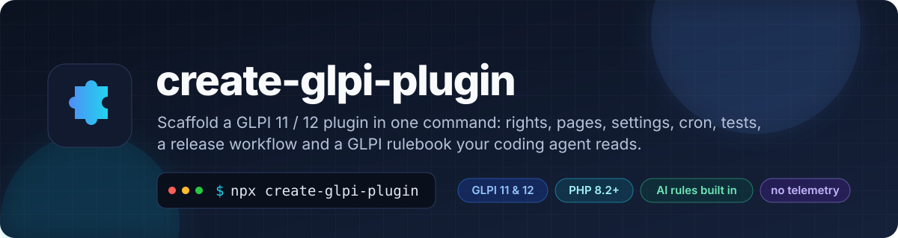

<p align="center">
  <a href="https://github.com/CodeByPinar/glpi-plugin-cli"></a>
</p>

<p align="center">
  <a href="../README.md">English</a> · <b>Türkçe</b>
</p>

<p align="center">
  <a href="#-neden">Neden</a> ·
  <a href="#-hızlı-başlangıç">Hızlı başlangıç</a> ·
  <a href="#-ne-üretir">Ne üretir</a> ·
  <a href="#-parçalar">Parçalar</a> ·
  <a href="#-seçenekler">Seçenekler</a> ·
  <a href="#-glpi-11-ve-12-için-tek-kod-tabanı">GLPI 11 &amp; 12</a> ·
  <a href="#-yapay-zekâ-kodlama-araçları">Yapay zekâ</a> ·
  <a href="#-üretilen-araç-kutusu">Araç kutusu</a> ·
  <a href="#-sss">SSS</a> ·
  <a href="#-yol-haritası">Yol haritası</a>
</p>

---

```bash
npx create-glpi-plugin
```

Tek komut, birkaç soru; elinizde kurulan, menüde görünen, hakları, ayar sayfası, aramalı ve geçmişli bir nesne
tipi, cron görevi, testleri, yayın hattı olan bir GLPI eklentisi var. Üstüne, kodlama asistanınızın dosyaya
dokunmadan önce okuduğu bir GLPI 11 / 12 tuzak rehberi.

<p align="center">
  
</p>

## 💡 Neden

GLPI eklentisi yazmak, ilk işe yarar satırdan önce bir yığın tören demek ve törenin çoğu belgelenmemiş:

| İstediğiniz | Önce bilmeniz gereken |
| :--- | :--- |
| Menü altında bir sayfa | `setup.php` kanca adları, `GlpiPlugin\Anahtar` ad alanı, `Html::header()`'ın menü sınıfınızı istediği, form action olarak `$_SERVER['PHP_SELF']` verirseniz POST'un sessizce GLPI'nin envanter ajanı uç noktasına gittiği |
| Profil başına hak | her profil için bir `glpi_profilerights` satırı, Profil formunda bir sekme, sonradan açılan profillere de satır veren bir kanca |
| Bir ayar | `glpi_configs` ve bağlam, yalnızca metin değerler, güncellemede asla sıfırlanmaması |
| Listesi olan bir tablo | `CommonDBTM`, asla değişmemesi gereken `rawSearchOptions()` id'leri, varlık kısıtı, statik dosyalar için `public/`, sınıf GLPI 11 **ve** 12'de yüklenecekse `$rightname`'in neden bildirilemeyeceği |
| Güncelleme yayımlamak | yalnızca *eklemesi* gerektiği, GLPI'nin `install()` çalışmadan önce sürümü üzerine yazdığı, sürüm artınca eklentinin biri *Güncelle*'ye basana kadar pasifleştiği |
| CSRF'nin çalışması | GLPI 11'in belirteci kendisinin denetlediği ve ikinci bir denetimin 403 verdiği, GLPI 12'de hiç belirteç olmadığı |

`create-glpi-plugin` bunların hepsini sizin yerinize, doğru biçimde ve on dakikada okunacak sadelikte yazar.
Uyduğu kurallar eklentinin içindeki `docs/glpi-rules.md` dosyasında, her biri önlediği belirtiyle birlikte
durur; böylece sizin veya yapay zekâ asistanınızın yapacağı sonraki değişiklik de aynı kurallara uyar.

`create-next-app`'in GLPI karşılığı: yığının gelenekleri ve ajanlar için bir "anayasa" ile gelen iskelet üreteci. Yazdığı her şey size ait düz PHP. Bu araca
çalışma zamanı bağımlılığı yok, çerçeve yok, telemetri yok.

## 🚀 Hızlı başlangıç

```bash
npx create-glpi-plugin                       # etkileşimli
npx create-glpi-plugin eklentim --yes        # varsayılanlar: GLPI 11+12, menü + ayarlar, Claude + Cursor kuralları, GPL
```

Sonra:

```bash
cp -r eklentim /var/www/glpi/plugins/        # geliştirirken sembolik bağ da olur
cd /var/www/glpi
php bin/console glpi:plugin:install eklentim -u glpi     # GLPI 12: plugin:install eklentim -u glpi
php bin/console glpi:plugin:activate eklentim
```

GLPI'de *Eklentiler → Eklentim*'i açın. Genel bakış sayfası neyin üretildiğini ve sırada ne olduğunu söyler.

Elinizde GLPI yok mu? Eklenti kendi geçici GLPI'siyle gelir:

```bash
cd eklentim/docker && docker compose up -d   # http://localhost:8080, glpi / glpi, bir dakikada kendini kurar
```

Gereksinimler: CLI için Node.js 20 veya üstü. Eklenti için PHP 8.2 (GLPI 11) ya da 8.3 (GLPI 12).

## 📦 Ne üretir

```text
eklentim/
├── setup.php                     sürüm, gereksinimler, kancalar, menü kaydı
├── hook.php                      kur / güncelle / kaldır — yalnızca ekleyici, sürüm kapılı geçişler
├── plugin.xml                    GLPI eklenti dizini bildirimi
├── src/                          GlpiPlugin\Eklentim\… (PSR-4, GLPI otomatik yükler, inc/ yok)
│   ├── Profile.php               haklar: READ, UPDATE, CREATE/DELETE/PURGE, CONFIG + Profiller'de sekme
│   ├── Ui.php                    pill gezinmeli sayfa başlığı, url(), csrf(), need(), e()
│   ├── Menu.php                  ara / ekle / ayarlar bağlantılı menü girdisi                 [menu]
│   ├── Config.php                glpi_configs'te ayarlar, doğrulamalı kayıt, önbellekli okuma  [config]
│   ├── Item.php                  CommonDBTM: arama motoru listesi, form, geçmiş, varlıklar    [itemtype]
│   ├── Cron.php                  parametreli ve günlüklü otomatik eylem                        [cron]
│   └── TicketTab.php             her talepte sekme                                            [tickettab]
├── front/                        index.php · config.php · item.php · item.form.php
├── public/css/eklentim.css       GLPI'nin statik dosya sunduğu tek klasör
├── locales/                      eklentim.pot + boş en_GB.mo (__() çağrılarını hızlı tutar)
├── docs/glpi-rules.md            GLPI 11 / 12 kuralları ve tuzakları, belirtileriyle
├── AGENTS.md                     her kodlama ajanı için kısa kurallar
├── CLAUDE.md                     + .claude/skills/glpi-plugin/SKILL.md                        [Claude Code]
├── .cursor/rules/glpi-plugin.mdc                                                              [Cursor]
├── tests/lint.sh                 her dosyada php -l
├── tests/loadcheck.php           her sınıfı bir GLPI kopyasına karşı yükler: imza hatalarını yakalar
├── tools/package.py              dist/eklentim-x.y.z.{tgz,zip,sha256} + changelog'dan sürüm notları
├── tools/i18n.sh                 .pot yenileme, .po → .mo
├── docker/docker-compose.yml     resmi glpi/glpi imajı, eklenti bağlı
├── .github/workflows/ci.yml      PHP 8.2–8.4'te sözdizimi, GLPI 11 ve 12 imajlarında gerçek kurulum
├── .github/workflows/release.yml vX.Y.Z etiketi → arşivler + GitHub sürümü
├── README.md · CHANGELOG.md · LICENSE · .gitignore · .gitattributes
```

`[…]` ile işaretli parçalar yalnızca seçildiğinde yazılır. Haklar, `Ui`, kural rehberi, test ve yayın araçları her
zaman vardır.

## 🧩 Parçalar

| Parça | Size verdiği | Kullandığı GLPI API'si | Dosyalar |
| :--- | :--- | :--- | :--- |
| **Menü** | seçtiğiniz bölümde (Eklentiler, Araçlar, Varlıklar, Destek, İşletme, Yönetim, Ayarlar) ara / ekle / ayarlar bağlantılı bir girdi; üretileni, kullanıcının haklarını ve cron durumunu listeleyen genel bakış sayfası | `Hooks::MENU_TOADD`, `CommonGLPI::getMenuContent()`, `Hooks::ADD_CSS` | `src/Menu.php`, `front/index.php`, `public/css/` |
| **Ayarlar** | *Ayarlar → Eklentiler*'den ve pill gezinmeden ulaşılan sayfa; doğrulamalı üç örnek alan (metin, sayı, anahtar); güncellemede eklenen ama asla ezilmeyen varsayılanlar | `Config::getConfigurationValues()` / `setConfigurationValues()`, `Hooks::CONFIG_PAGE` | `src/Config.php`, `front/config.php` |
| **Nesne tipi** | `glpi_plugin_eklentim_items` tablosu, GLPI arama motoru (ölçütler, sütunlar, dışa aktarma, toplu işlemler), standart form, geçmiş sekmesi, varlık kısıtı, haklı ekle / güncelle / sil | `CommonDBTM`, `rawSearchOptions()`, `Search::show()`, `$item->display()` | `src/Item.php`, `front/item.php`, `front/item.form.php`, `hook.php`'de tablo |
| **Otomatik eylem** | *Ayarlar → Otomatik eylemler*'de görünen, parametreli, günlük satırı yazan, 1 / 0 / -1 dönüş sözleşmeli, tekrar kurulumda çoğalmayan cron görevi | `CronTask::register()`, `cronInfo()`, `cron<Ad>()` | `src/Cron.php` |
| **Talep sekmesi** | her talepte bir sekme; GLPI'nin beklediği imzalarla, başka nesne tipine çevrilmeye hazır | `Plugin::registerClass(…, ['addtabon' => 'Ticket'])`, `getTabNameForItem()`, `displayTabContentForItem()` | `src/TicketTab.php` |
| **Haklar** *(her zaman)* | GLPI'nin standart bitleri + `CONFIG` bitiyle tek `plugin_eklentim` hakkı, *Yönetim → Profiller*'de sekme, taze kurulumda mantıklı varsayılanlar (yöneticiye hepsi, merkezî profillere okuma, self-servise hiçbiri), sonradan açılan her profile satır | `ProfileRight`, `displayRightsChoiceMatrix()`, Profile üzerinde `Hooks::ITEM_ADD` | `src/Profile.php` |
| **Ui** *(her zaman)* | `Ui::header('sayfa', $başlık)` GLPI çerçevesini, başlığınızı ve pill gezinmeyi çizer; `Ui::url()` doğru form action üretir; `Ui::csrf()` belirteci yalnızca GLPI'de varsa basar; `Ui::need(READ)` iki sürümde de doğru 403'ü fırlatır | `Html::header()`, `Session::getNewCSRFToken()`, `AccessDeniedHttpException` | `src/Ui.php` |

**Nesne tipi** seçilince **Menü** de seçilir; nesne sayfalarının yaşayacağı bir yer gerekir.

## ⚙️ Seçenekler

Her sorunun bir bayrağı var. Bayrak sorusunu yanıtlar; `--yes` kalanları varsayılanla doldurur.

```bash
npx create-glpi-plugin envanternotu \
  --display "Envanter Notu" \
  --description "Her varlığa serbest metin not, geçmişli" \
  --author "Ayşe Yılmaz" \
  --glpi both \
  --features menu,itemtype,cron \
  --sector assets \
  --agent claude \
  --license GPL-3.0-or-later \
  --repo https://github.com/ayse/glpi-envanternotu \
  --tr --yes
```

| Seçenek | Değerler | Varsayılan |
| :--- | :--- | :--- |
| `[anahtar]` | harfle başlayan 2–30 küçük harf ve rakam. Klasör, `GlpiPlugin\Anahtar`, `glpi_plugin_anahtar_*`, `plugin_anahtar` olur | sorulur |
| `--display <ad>` | Ayarlar → Eklentiler ve menüdeki ad | anahtar, baş harfi büyük |
| `--description <metin>` | tek satır; sayfa başlığı altında ve `plugin.xml`'de | `<ad> plugin for GLPI` |
| `--author <ad>` | | `git config user.name` |
| `--glpi` | `both` · `11` · `12` | `both` |
| `--features` | virgülle `menu`, `config`, `itemtype`, `cron`, `tickettab` ya da `none` | `menu,config` |
| `--sector` | `plugins` · `tools` · `admin` · `management` · `assets` · `helpdesk` · `config` | `plugins` |
| `--agent` | `claude`, `cursor` ya da `none` (AGENTS.md ve rehber her zaman yazılır) | `claude,cursor` |
| `--license` | `GPL-3.0-or-later` (GLPI'ninki) · `MIT` | `GPL-3.0-or-later` |
| `--repo <url>` | `setup.php`, `plugin.xml` ve README'ye yazılan depo adresi | yer tutucu |
| `--icon <sınıf>` | menü ve sekmeler için [Tabler ikon](https://tabler.io/icons) sınıfı | `ti ti-puzzle` |
| `--dir <yol>` | çıktı klasörü | `./<anahtar>` |
| `--force` | boş olmayan klasöre yaz | |
| `--no-git` | `git init` ve ilk commit'i atla | |
| `-y`, `--yes` | soru sorma | |
| `--tr` | Türkçe sorular (`LANG` `tr` ile başlıyorsa kendiliğinden) | |
| `-v`, `--version` · `-h`, `--help` | | |

Üretilen kod ve belgeler İngilizcedir: GLPI eklenti ekosisteminin dili bu, ve yapay zekâ araçları İngilizce
kuralları daha iyi izliyor. Sorular Türkçe; eklentinizin arayüz metinlerini `locales/tr_TR.po` ile çevirirsiniz.

## 🔀 GLPI 11 ve 12 için tek kod tabanı

`--glpi both` (varsayılan) ile üretilen kod iki sürümde de değişmeden çalışır. Soğurduğu farklar şunlar;
rehber her birini belirtisiyle anlatır.

| Konu | GLPI 11 | GLPI 12 | Üretilen kod ne yapar |
| :--- | :--- | :--- | :--- |
| CSRF | her POST'ta `_glpi_csrf_token`, `Hooks::CSRF_COMPLIANT` | belirteçler ve sabit kaldırıldı | `Ui::csrf()` alanı yalnızca `Session::getNewCSRFToken()` varsa basar; kanca `defined()` arkasında; sayfalar asla `checkCSRF()` çağırmaz |
| `CommonGLPI::$rightname` | tipsiz | `string` | yeniden bildirilmez: `canView()`…`canPurge()` ezilir ve `Profile::has()`'a sorar |
| `CommonDBTM::$dohistory` | tipsiz | `bool` | yeniden bildirilmez: kurucuda atanır |
| Erişim reddi | `Html::displayRightError()` | kaldırıldı | `throw new AccessDeniedHttpException()` (ikisinde de çalışır) |
| Ham SQL | `$DB->query()` kullanımdan kalktı | kaldırıldı | `$DB->request()`, `insert()`, `update()`, `delete()`, `doQuery()` |
| Konsol | `glpi:plugin:install` | `plugin:install` | ikisi de README'de, sürüm notlarında ve genel bakışta |
| PHP | ≥ 8.2 | ≥ 8.3 | `requirements.php.min` hedefe göre |

Üretilen sınıfların ezdiği her yöntemin imzası GLPI 11.0.8 ve 12.0.0'da aynı; yukarıdaki özellik tipleri tek
kırılma noktası ve **`tests/loadcheck.php`** bunları tarayıcısız, veritabanısız yakalar. `--glpi 11` ya da
`--glpi 12` ile sürüme özgü parçalar düşer ve `plugin.xml` yalnızca o hattı listeler.

## 🤖 Yapay zekâ kodlama araçları

Kodlama asistanları GLPI 11'i bilmez. Doğru görünen ama üretimde patlayan GLPI 9 dönemi eklentiler üretirler
(`inc/`, `PluginAnahtarSinif`, `$_SERVER['PHP_SELF']`, elle CSRF denetimi). Üretilen eklenti kuralları her aracın
okuduğu biçimde verir:

| Dosya | Kime | İçerik |
| :--- | :--- | :--- |
| `AGENTS.md` | her ajan (Codex, Copilot, Claude, Cursor, …) | yerleşim, kolay çiğnenen on kural, komutlar, "bitti" tanımı |
| `docs/glpi-rules.md` | insanlar ve ajanlar | tam rehber: yapı ve adlandırma, GLPI 11 ve 12, sayfalar, kurulum / güncelleme, nesne tipleri ve arama motoru, yerel formlar, performans, tarayıcısız test, yayın listesi. Her kural belirtisini söyler |
| `CLAUDE.md` | Claude Code | `AGENTS.md`'yi içe alır, skill'e ve doğrulama komutlarına yönlendirir |
| `.claude/skills/glpi-plugin/SKILL.md` | Claude Code | tarifler: yeni sayfa, hak, ayar, sütun, nesne tipi, cron, nesnede sekme, olay kancası, çeviri, yayın |
| `.cursor/rules/glpi-plugin.mdc` | Cursor | kısa kurallar, PHP dosyalarına her zaman uygulanır |

Rehber resmî belgenin özeti değil; GLPI 11.0.x ve 12.0.x'te eklenti yayımlarken tutulmuş saha notları. Tadımlık:

> **Form action olarak asla `$_SERVER['PHP_SELF']` kullanmayın.** GLPI 11'in yönlendiricisi bunu `/index.php`'ye
> çözer, POST envanter ajanı uç noktasına düşer ve `<REPLY><ERROR>XML not well formed!</ERROR></REPLY>` döner.

> **Sayfada `Session::checkCSRF()` çağırmayın.** GLPI 11 her POST'u çekirdek dinleyicide doğrular ve bu doğrulama
> tek kullanımlık belirteci *tüketir*; ikinci denetiminiz 403 verir.

> **`Html::redirect()` istisna fırlatır.** Etrafındaki `catch (\Throwable)` yönlendirmeyi yutar ve sayfa yanlış
> yere "başarıyla" iner.

## 🧰 Üretilen araç kutusu

| Komut | Ne yapar |
| :--- | :--- |
| `bash tests/lint.sh` | her dosyada `php -l` |
| `bash tests/lint.sh /var/www/glpi` | … artı **yük kontrolü**: her eklenti sınıfını GLPI'yi açmadan o GLPI'nin çekirdek sınıflarına karşı yükler. GLPI'ninkinden kayan bir imza ya da GLPI'nin tiplediği bir özellik, konsolun hiç tetiklemediği ve tarayıcının beyaz sayfa gösterdiği derleme hatasıdır. Burada terminalde kırmızı bir satır |
| `python tools/package.py` | yalnızca eklenti dosyalarıyla, arşiv kökünde `eklentim/` klasörü, root sahipli, 644 izinli `dist/eklentim-x.y.z.tgz`, `.zip`, `.sha256` üretir: GLPI kurucusunun ve marketplace'in beklediği biçim |
| `python tools/package.py --notes` | geçerli sürümün changelog bölümünü kurulum talimatıyla basar; sürüm notu olarak kullanılır |
| `bash tools/i18n.sh` | kaynaklardan `locales/eklentim.pot`'u yeniler (`__('…', 'eklentim')`, `_n`, `_x`, `_sx`) ve her `.po`'yu `.mo`'ya derler |
| `cd docker && docker compose up -d` | <http://localhost:8080> adresinde GLPI 11 (ya da `GLPI_TAG=12.0` ile 12), eklenti klasörü bağlı; düzenlemeler anında görünür |
| `.github/workflows/ci.yml` | her push'ta: PHP 8.2 / 8.3 / 8.4'te sözdizimi, sonra **gerçek kurulum**: resmî `glpi/glpi` imajı veritabanını kurar, `plugin:install`, `plugin:activate`, konteyner içinde yük kontrolü, giriş sayfası yanıt verir |
| `.github/workflows/release.yml` | `git tag vX.Y.Z` ile: etiketi `PLUGIN_EKLENTIM_VERSION` ile karşılaştırır, arşivleri üretir, changelog bölümünü not olarak GitHub sürümü yayımlar |

Kurulum kancası çoğu eklentinin yanlış yaptığı tek kurala uyar: **güncellemeler ekleyicidir**. Tablolar ve sütunlar
`tableExists()` / `fieldExists()` arkasında eklenir; haklar yalnızca satırı olmayan profillere; ayarlar yalnızca
anahtar yoksa; tek seferlik geçişler daha önce `install()` çalıştıran sürüme kapılıdır. GLPI `glpi_plugins.version`'ı
sizi çağırmadan önce üzerine yazdığı için `hook.php` o sürümü `schema_version` ayarında tutar. Yeniden kurmak,
yükseltmek ya da `plugin:install --force` çalıştırmak yöneticinin yapılandırdığı hiçbir şeyi sıfırlamaz.

## 🛠 İlk özelliğiniz

Diyelim `envanternotu`'nu nesne tipiyle ürettiniz. Örnek `Item`'ı bir bilgisayara bağlı *Not*'a çevirmek dört
düzenleme; skill ve rehber bir ajanı aynı adımlardan geçirir:

1. **Sütun**: `hook.php`'de `CREATE TABLE`'ın yanına
   `if (!$DB->fieldExists(Item::TABLE, 'computers_id')) { $DB->doQuery("ALTER TABLE … ADD `computers_id` INT … DEFAULT 0"); }`
   (kurulum güncellemede de çalışır; bu aynı zamanda mevcut kurulumların geçişidir).
2. **Arama seçeneği**: `Item::rawSearchOptions()`'a yeni id'li bir girdi, `'table' => Computer::getTable()`,
   `'datatype' => 'dropdown'`. Id'ler kayıtlı aramalarda saklanır: birini seçin ve değiştirmeyin.
3. **Form**: `Item::showForm()`'a `Computer::dropdown(['name' => 'computers_id', 'value' => $this->fields['computers_id']])`.
4. **Yayın**: `PLUGIN_ENVANTERNOTU_VERSION`'ı artırın, changelog satırı ekleyin, `git tag v0.2.0 && git push --tags`.
   Yöneticilere eklentinin "güncellenecek" göründüğünü ve *Güncelle → Etkinleştir* gerektiğini söyleyin.

Notlar bilgisayarda sekme olsun mu? `TicketTab.php`'yi kopyalayın, `Ticket`'ı `Computer` yapın,
`['addtabon' => 'Computer']` ile kaydedin. Gece temizliği mi? `Cron` sınıfı dönüş sözleşmesi ve parametresiyle hazır.

## 📊 Karşılaştırma

| | Mevcut eklentiyi kopyalamak | GLPI'nin `example` eklentisi | `generator-glpi-plugin` (Yeoman, 2023) | **create-glpi-plugin** |
| :--- | :--- | :--- | :--- | :--- |
| GLPI 11 / 12 hedefler | duruma göre | evet | GLPI 9 | **ikisi, tek kod tabanı** |
| Haklar, ayarlar, nesne tipi, cron, sekme | kaynakta ne varsa | hepsini birden gösterir | yalnızca iskelet | **parçaları seçersiniz** |
| Ekleyici kurulum / geçişler | nadiren | hayır | hayır | **evet, önceki sürüme kapılı** |
| GLPI 11 / 12 imza hatalarını yakalar | hayır | hayır | hayır | **`tests/loadcheck.php`** |
| Test, CI, sürüm arşivleri | sizin sorununuz | hayır | hayır | **dahil** |
| Kodlama ajanları için kurallar | hayır | hayır | hayır | **AGENTS.md, rehber, Claude skill, Cursor kuralları** |
| Türkçe | | | | **sorular; kod ve belgeler İngilizce** |

## ❓ SSS

**Üretilen eklenti bu araca bağımlı mı?**
Hayır. GLPI'nin beklediği yerleşimde düz PHP. Hiçbir şeyi silmeyin, her şeyi tutun, istediğinizi değiştirin.

**Neden varsayılan lisans GPL-3.0-or-later?**
GLPI GPL-3.0; onu genişleten eklenti de genelde öyle olur. MIT bir bayrak uzağınızda.

**Sürümü değiştirince GLPI neden "güncellenecek" diyor?**
Bu GLPI'nin davranışı: dosyaların sürümü veritabanındakinden farklıysa eklenti biri *Güncelle* sonra *Etkinleştir*'e
basana kadar pasifleşir. Üretilen kurulum kancası bu tıklamayı güvenli yapar: yöneticinin yapılandırdığı hiçbir şey
sıfırlanmaz. İnsanlar yapıları ayırt edebilsin diye her teslimde sürümü artırın.

**Sonradan parça ekleyebilir miyim?**
O parçayla geçici bir eklenti üretip dosyaları kopyalayın; her parça kendi içinde bütündür ve skill'de anlatılır
(`yeni nesne tipi`, `yeni cron`, `nesnede sekme`). Mevcut eklentiler için `create-glpi-plugin add <parça>` komutu yol
haritasında.

**GLPI 10'u destekliyor mu?**
Hayır. GLPI 10'un sayfa yaşam döngüsü farklı (çekirdek yok, girdi temizleme, `inc/` otomatik yükleme). Buradaki her
şey 11 ve 12 için yazıldı.

**Neden boş bir `locales/en_GB.mo`?**
GLPI bir eklentinin metin alanını yalnızca `.mo` dosyası varsa kaydeder. Yoksa her `__('…', 'anahtar')` çağrısı
yükleyiciyi yeniden çalıştırır (her biri ≈150 µs; iki bin çağrılı bir sayfa üçte bir saniye kaybeder). Boş dosya
alanı tanıtır; istediğinizde çevirirsiniz.

**Eve telefon ediyor mu?**
Hayır. Telemetri yok, güncelleme denetimi yok, `npm`'in paketi indirmesi dışında ağ erişimi yok.

**CI'da etkileşimli mod?**
Bayraklarla `--yes` kullanın; sorular atlanır, anahtar eksikse ipucu veren bir hata alırsınız.

## 🗺 Yol haritası

- Mevcut eklentiler için `create-glpi-plugin add <parça>`: `settings-page`, `dashboard-card`, `notification`,
  `form-destination` (GLPI 11 Formlar), `rest-client`, `pill-menu`; bir kayıt defterinden çekilir, yeni parça için
  CLI sürümü gerekmez.
- `--template minimal|full` ön ayarları ve dosya planını basan `--dry-run`.
- PHP ile basılan HTML'e alternatif Twig tabanlı sayfalar (`TemplateRenderer`).
- Üretilen eklentide GLPI stub'larıyla PHPStan yapılandırması.
- Yalnızca PHP ortamları için `composer create-project` sarmalayıcısı.
- Sorular için daha fazla dil.

Fikir ve hata bildirimleri: [issues](https://github.com/CodeByPinar/glpi-plugin-cli/issues).

## 🧑‍💻 Geliştirme

```bash
git clone https://github.com/CodeByPinar/glpi-plugin-cli && cd glpi-plugin-cli
npm install
npm run check          # her dosyada node --check + test paketi
node bin/create-glpi-plugin.js demo --yes --dir /tmp/demo
```

Test paketi her parça bileşimini geçici bir klasöre üretir, dosya planını doğrular, şablon sözdiziminin sızmadığını
denetler ve PHP kuruluysa çıktıda `php -l` çalıştırır. CI ayrıca tam bir eklenti üretip sürüm arşivlerini kurar.
Şablonlar her sürümden önce GLPI 11.0.8 ve 12.0.0 üzerinde kuruldu, çalıştırıldı (sayfalar, geçmişli kayıt
ekle/güncelle/sil, ayar doğrulama, self-servis kullanıcıya 403, cron, talep sekmesi, ekleyici yeniden kurulum,
kaldırma temizliği) ve tarayıcıda görüntülendi.

## 🙏 Teşekkür

- Teclib' ve katkıcılarının [GLPI](https://glpi-project.org)'si.
- Sorular için [@clack/prompts](https://github.com/bombshell-dev/clack).

## 📄 Lisans

MIT © [Pınar Topuz](https://github.com/CodeByPinar). Üretilen eklenti sizin seçtiğiniz lisansı taşır.
